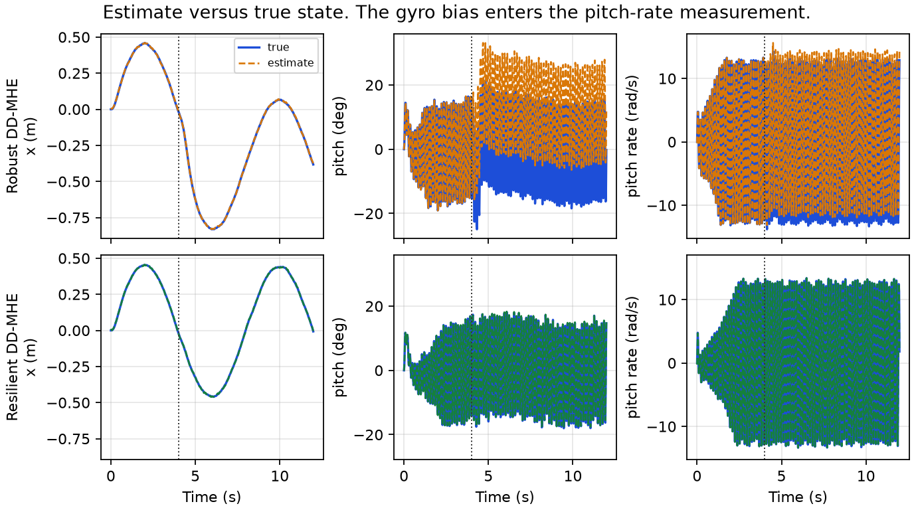

# Data-driven moving horizon estimation

Python examples of data-driven moving horizon estimation (DD-MHE). The shared library is `ddmhe`. Two applications compare **Robust DD-MHE** with the proposed **Resilient DD-MHE** when a sensor is biased: a planar quadrotor on a figure-8, and the IEEE 14-bus system.

```
@article{brunke2021safe,
         title={Resilient Data-driven Moving-Horizon Estimation against Adversarial Attacks},
         author={Yu Zheng, olugbenga Moses Anubi},
         journal = {},
         year={2027},
         url = {}}
```

## Setup

The repository does not commit a virtual environment. Create one with Python 3.11 or newer (the pinned stack below was run on Python 3.13), then install `requirements.txt`. That file covers `ddmhe`, the IEEE 14-bus example, and the linear figure-8.

```bash
python -m venv .venv
```

Windows (PowerShell):

```powershell
.venv\Scripts\Activate.ps1
python -m pip install --upgrade pip
python -m pip install -r requirements.txt
```

macOS and Linux:

```bash
source .venv/bin/activate
python -m pip install --upgrade pip
python -m pip install -r requirements.txt
```

The nonlinear Crazyflie flight also needs the packages in `requirements-gym.txt`, after the safe-control-gym submodule is present:

```bash
git submodule update --init quadrotor/safe-control-gym
python -m pip install -r requirements-gym.txt
```

## Data-driven MHE

A moving-horizon estimator reconstructs the recent state from a short window of inputs and outputs. DD-MHE does that fit against a Hankel dictionary recorded offline, so the online program does not contain a state-space model.

**Offline dictionary.** One persistently exciting trajectory is arranged into block-Hankel matrices of the input, the output, and the state. `rank_analysis` checks the standard persistence-of-excitation condition: the input Hankel matrix of order `L + n` has full row rank, where `L` is the horizon and `n` is the state dimension. `build_compressed_hankel` keeps the joint numerical column space of those three matrices. `save_hankel` writes the compressed dictionary and a JSON sidecar. The preparation script prints this rank report and exits if the input is rank-deficient.

**Online window.** At each time the solver represents the latest window as a linear combination of the dictionary columns. The measured input is matched exactly. The estimated state is the same combination of the state columns. A forgetting factor `rho = 0.95` gives recent samples more weight. The arrival cost on the state at the start of the window is

```text
P · rho^(d − 1) · ||x0 − prior||,    P = 1,
```

with measurement weight `R = 10`. Both estimators share this arrival cost. They differ in the measurement term:

| | Robust DD-MHE | Resilient DD-MHE |
| --- | --- | --- |
| Measurement term | squared residual | absolute residual |
| Constant sensor bias | the squared penalty draws the state toward the biased sensor | the absolute penalty leaves a sparse bias in a slack variable |

`make_dd_mhe_pair` builds both solvers on one dictionary. Each window is solved with [CLARABEL](https://github.com/oxfordcontrol/ClarabelDocs), and with [SCS](https://www.cvxgrp.org/scs/) if CLARABEL does not return a solution.

```python
from ddmhe import load_hankel, make_dd_mhe_pair

_u, _y, _x, hu, hy, hx, meta = load_hankel("quadrotor/offline/hankel.npz")
solvers = make_dd_mhe_pair(
    hu,
    hy,
    hx,
    horizon=int(meta["horizon"]),
    p_weight=1.0,
    r_weight=10.0,
    rho=0.95,
)
window = solvers["Resilient DD-MHE"].estimate(u_window, y_window, prior)
```

Every example is two scripts. The first records the offline trajectory, prints the Hankel rank, and saves the dictionary. The second loads that file and runs the online estimate.

## Examples

Run the commands from the repository root, with the virtual environment from [Setup](#setup) activated.

### 1. Planar quadrotor

The plant is the [safe-control-gym](https://github.com/learnsyslab/safe-control-gym) two-dimensional Crazyflie, linearized at hover and pinned in this repo at commit `6b5391d`. States are deviations `[x, x_dot, z, z_dot, theta, theta_dot]`. Outputs are horizontal position, altitude, pitch, pitch rate, and the vertical specific force at the center of mass. The sample time is `0.02 s` and the horizon is `L = 20`. Scaled sensor noise is `N(0, 0.1^2)`.

`quadrotor/prepare_offline.py` rolls the linear plant out about hover, checks the Hankel rank, and writes `quadrotor/offline/hankel.npz`. On the recorded rollout the input Hankel matrix of order `L + n = 26` has rank 52 / 52. `quadrotor/simulate_quadrotor.py` loads that dictionary and closes an LQR loop around each estimator. The reference is one figure-8 in the vertical plane,

```text
x = 0.45 sin(ω t) m,    z = 0.22 sin(2 ω t) m,    ω = 2π / 8 s,
```

flown for `12 s`. An `8 rad/s` pitch-rate bias starts at `t = 4 s`, at the center crossing of the loop.

```bash
python -m quadrotor.prepare_offline
python -m quadrotor.simulate_quadrotor
```

The script opens the safe-control-gym PyBullet window at the start. The figure-8 faces the camera. Drag to orbit, scroll to zoom, and Ctrl+drag to pan. The orange vehicle is Robust DD-MHE and the green vehicle is Resilient DD-MHE; both move while the estimators are solving, not as a replay afterward. The blue beads are the figure-8 and the red bead is the current reference point. The plots are written when the estimators finish; close the window after that. `--no-gui` skips the window. It needs the packages in `requirements-gym.txt` and the safe-control-gym submodule.

After the bias, Robust DD-MHE leaves the figure-8 in `x` (RMSE `0.360 m`). Resilient DD-MHE stays on the reference (`0.009 m`). Altitude tracking stays near `6 mm` for both. The animation below is that pair of flights. The label switches to "gyro bias on" at `t = 4 s`.


Tracking RMSE against the reference, from `quadrotor/quadrotor_results.json`:

| Interval | Channel | Robust DD-MHE | Resilient DD-MHE |
| --- | --- | ---: | ---: |
| Before the bias | `x` (m) | 0.015 | 0.016 |
| Before the bias | `z` (m) | 0.008 | 0.009 |
| After the bias | `x` (m) | 0.360 | 0.009 |
| After the bias | `z` (m) | 0.006 | 0.006 |

The vehicle leaves the path because of the pitch estimate. After the bias, both estimators still follow the true horizontal position (RMSE about `3 mm`). Robust DD-MHE folds the gyro bias into pitch (RMSE `11.7 deg`) and pitch rate (RMSE `1.30 rad/s`). The LQR acts on that pitch estimate, so `x` drifts off the figure-8. Resilient DD-MHE keeps the pitch error at `0.27 deg` and the pitch-rate error at `0.030 rad/s`.

| Interval | Estimate error | Robust DD-MHE | Resilient DD-MHE |
| --- | --- | ---: | ---: |
| After the bias | pitch (deg) | 11.67 | 0.27 |
| After the bias | pitch rate (rad/s) | 1.303 | 0.030 |
| After the bias | `x` (m) | 0.0025 | 0.0029 |



`quadrotor/fly_quadrotor_gym.py` repeats the same figure-8 on the nonlinear Crazyflie. It builds its own Hankel dictionary at `60 Hz` with `make_dd_mhe_pair`, because that sample time differs from the linear example. Initialize the submodule before that script:

```bash
git submodule update --init quadrotor/safe-control-gym
python -m quadrotor.fly_quadrotor_gym
```

### 2. IEEE 14-bus power system

The online script estimates generator angle and speed deviations of the linearized IEEE 14-bus plant (`n = 10`, `p = 19`, `m = 19`, sample time `0.01 s`, horizon `L = 6`). The discrete matrices in `power/ieee14/` come from [Moving-horizon-FDIA](https://github.com/ZYblend/Moving-horizon-FDIA) (`demo_14_bus_system`).

`power/prepare_ieee14.py` rolls out one persistently exciting trajectory, checks the Hankel rank, and writes `power/offline/ieee14_hankel.npz`. The input Hankel matrix of order `L + n = 16` has rank 304 / 304. Online, scaled measurements have noise `N(0, 0.1^2)`. From `t = 1.5 s`, a constant bias of `40` scaled units is added to the first `k` bus power-injection sensors (measurement channels 5 through 9).

```bash
python power/prepare_ieee14.py
python power/simulate_ieee14.py
```

State RMSE is the root-mean-square, over the run, of the Euclidean state error. Saved in `power/ieee14_results.json`:

| Attacked sensors `k` | Robust DD-MHE | Resilient DD-MHE |
| ---: | ---: | ---: |
| 0 | 0.0013 | 0.0015 |
| 1 | 0.1777 | 0.0018 |
| 2 | 0.1104 | 0.0016 |
| 3 | 0.1091 | 0.0016 |
| 4 | 0.0933 | 0.0016 |
| 5 | 0.0936 | 0.0016 |

With no attack the two estimators are close. Under the sensor biases, Robust DD-MHE state RMSE rises by about two orders of magnitude, while Resilient DD-MHE stays near the unattacked error.

The figure below is the `k = 3` run: three bus power-injection biases from `t = 1.5 s`. Resilient DD-MHE stays on the true angles and speeds. Robust DD-MHE steps away at the attack and stays offset.


## Layout

| Path | Contents |
| --- | --- |
| `ddmhe/` | Hankel construction, the rank check, and `make_dd_mhe` / `make_dd_mhe_pair` |
| `quadrotor/` | Figure-8 flight. Prepare with `prepare_offline.py`, then run `simulate_quadrotor.py` |
| `power/` | IEEE 14-bus attack sweep. Prepare with `prepare_ieee14.py`, then run `simulate_ieee14.py` |
