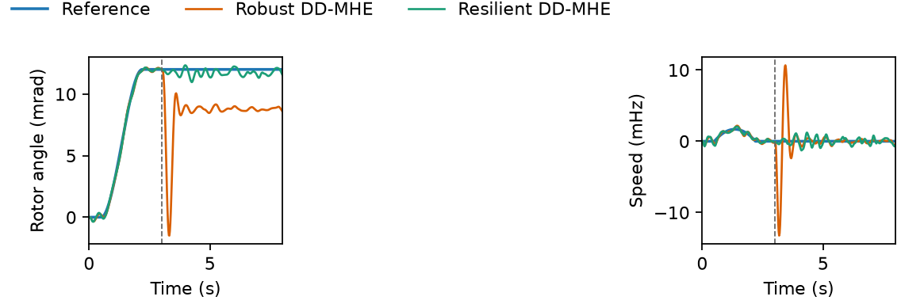

# Data-driven moving horizon estimation

Data-driven moving horizon estimation (DD-MHE) from a persistently exciting input-output Hankel matrix, together with two application examples that compare **Robust DD-MHE** and the proposed **Resilient DD-MHE**.

Robust DD-MHE penalizes the squared measurement residual. Resilient DD-MHE penalizes the absolute residual, with a forgetting factor, so a sparse set of sensor biases can be rejected. When the offline Hankel matrix is persistently exciting, the data-driven estimates agree with the matching model-driven estimators. The tables below report the data-driven pair.

## Application examples

Run the Python examples from the repository root. The quadrotor flight uses [safe-control-gym](https://github.com/learnsyslab/safe-control-gym) as a submodule pinned at `6b5391d`. After cloning this repository:

```bash
git submodule update --init quadrotor/safe-control-gym
```

### 1. Power systems

#### IEEE 14-bus

`power/explore_ieee14.py` estimates the generator angle and speed deviations of the linearized IEEE 14-bus plant (`n = 10`, `p = 19`, `m = 19`, sample time `0.01 s`, horizon `L = 6`). The discrete matrices in `power/ieee14/` come from [Moving-horizon-FDIA](https://github.com/ZYblend/Moving-horizon-FDIA) (`demo_14_bus_system`). Offline data are one persistently exciting rollout of that linear model. Online, scaled measurements have noise `N(0, 0.1^2)`. From `t = 1.5 s`, a constant bias of `40` scaled units is added to the first `k` bus power-injection sensors (measurement channels 5 through 9).

```bash
python power/explore_ieee14.py
```

State RMSE is the root-mean-square, over the run, of the Euclidean state error. Saved in `power/ieee14_results.json`:

| Attacked sensors `k` | Robust DD-MHE | Resilient DD-MHE |
| ---: | ---: | ---: |
| 0 | 0.0013 | 0.0015 |
| 1 | 0.1777 | 0.0018 |
| 2 | 0.1104 | 0.0016 |
| 3 | 0.1091 | 0.0016 |
| 4 | 0.0933 | 0.0016 |
| 5 | 0.0936 | 0.0016 |

With no attack the two estimators are close. Under the sensor biases, Robust DD-MHE state RMSE rises by about two orders of magnitude, while Resilient DD-MHE stays near the unattacked error. The model-driven pair matches these values at the reported precision. Re-running the script overwrites `power/ieee14_mhe.png` with the time series for this table. The plot already in that file is from an earlier short run (two biases from `t = 0.6 s`) and is not the table above.

#### Single-machine infinite bus

`power/explore_smib.py` runs the same comparison on the ANDES textbook SMIB (classical machine against an infinite bus). The known input is a mechanical-torque deviation. Outputs are rotor angle, rotor speed, and electrical power. A speed bias of `0.001 pu` starts at `t = 2 s`. ANDES is imported from the installed package.

```bash
python power/explore_smib.py
```

Open-loop estimates are in `power/smib_mhe.png`. The closed-loop figure uses the data-driven estimates in the torque command: a feedforward torque for a slow angle move, minus a linear gain on the estimated tracking error.



After the speed bias, Robust DD-MHE leaves the angle reference and settles at the wrong angle. Resilient DD-MHE stays on the reference, and its speed returns to the same small oscillation as before the bias.

### 2. Planar quadrotor

The plant is the safe-control-gym two-dimensional Crazyflie, linearized at hover. States are deviations `[x, x_dot, z, z_dot, theta, theta_dot]`. Outputs are horizontal position, altitude, pitch, pitch rate, and the vertical specific force at the center of mass. The sample time is `0.02 s` and the horizon is `L = 20`. Scaled sensor noise is `N(0, 0.1^2)`.

`quadrotor/simulate_quadrotor.py` compares the four estimators on a waypoint move (`0.40 m` in `x`, `0.20 m` in `z`). The attacked case adds an `8 rad/s` bias to the pitch-rate measurement from `t = 3 s`.

```bash
python -m quadrotor.simulate_quadrotor
```

RMSE from `quadrotor/quadrotor_results.json`:

| Case | Channel | Robust DD-MHE | Resilient DD-MHE |
| --- | --- | ---: | ---: |
| No attack | `x` (m) | 0.0025 | 0.0027 |
| No attack | `z` (m) | 0.0023 | 0.0027 |
| No attack | pitch (deg) | 0.132 | 0.164 |
| Gyro bias | `x` (m) | 0.0027 | 0.0027 |
| Gyro bias | `z` (m) | 0.0023 | 0.0027 |
| Gyro bias | pitch (deg) | 8.070 | 0.233 |

Position error stays near a few millimeters in every case. The gyro bias is absorbed by Robust DD-MHE as a pitch error of `8.07 deg` RMSE (`12.2 deg` peak). Resilient DD-MHE keeps the pitch RMSE at `0.23 deg` (`0.70 deg` peak). The model-driven pair again matches the data-driven numbers.

`quadrotor/fly_quadrotor_gym.py` closes the same linear-quadratic regulator around each data-driven estimate and integrates the safe-control-gym planar Crazyflie. The recording below is that flight with the pitch-rate bias.

```bash
python -m quadrotor.fly_quadrotor_gym
```

[Closed-loop flight, Robust DD-MHE and Resilient DD-MHE](quadrotor/quadrotor_feedback_corrected.mp4)
