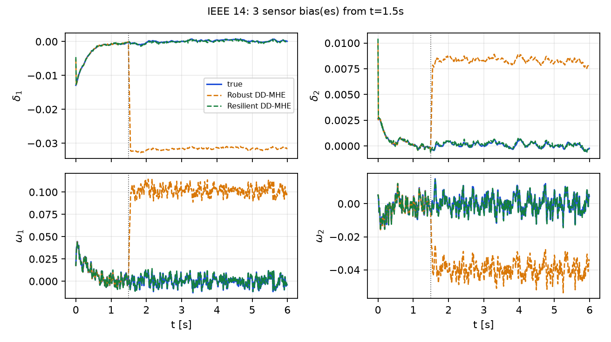
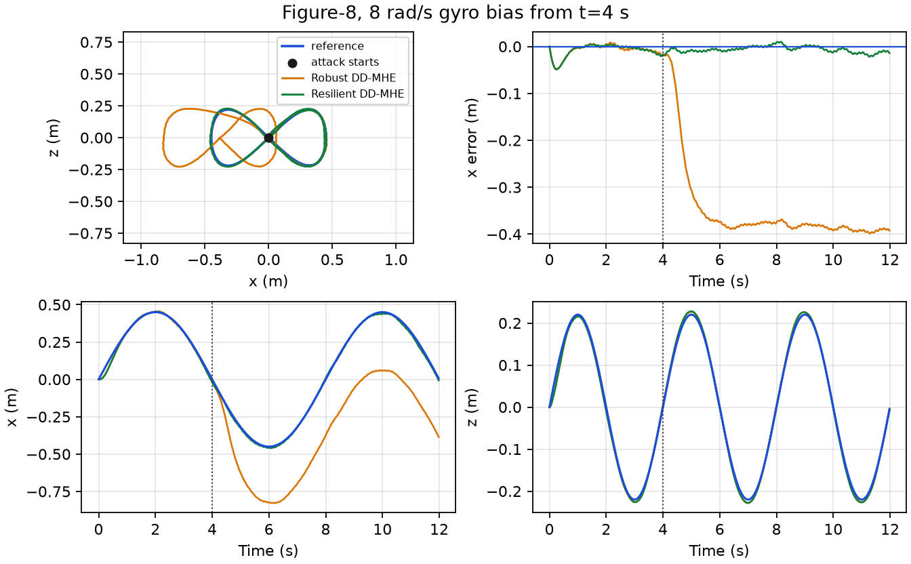
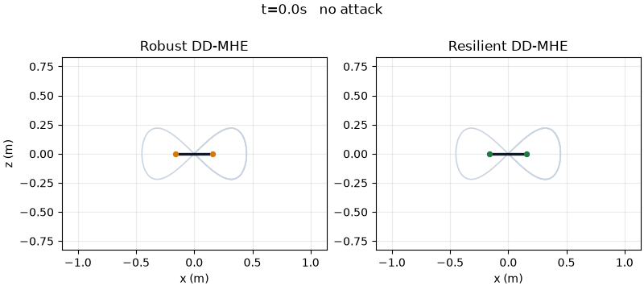

# Data-driven moving horizon estimation

Data-driven moving horizon estimation (DD-MHE) from a persistently exciting input-output Hankel matrix, together with two application examples that compare **Robust DD-MHE** and the proposed **Resilient DD-MHE**.

Robust DD-MHE penalizes the squared measurement residual. Resilient DD-MHE penalizes the absolute residual, with a forgetting factor, so a sparse set of sensor biases can be rejected. When the offline Hankel matrix is persistently exciting, the data-driven estimates agree with the matching model-driven estimators. The tables below report the data-driven pair.

## Application examples

Run the Python examples from the repository root. The quadrotor flight uses [safe-control-gym](https://github.com/learnsyslab/safe-control-gym) as a submodule pinned at `6b5391d`. After cloning this repository:

```bash
git submodule update --init quadrotor/safe-control-gym
```

### 1. IEEE 14-bus power system

`power/explore_ieee14.py` estimates the generator angle and speed deviations of the linearized IEEE 14-bus plant (`n = 10`, `p = 19`, `m = 19`, sample time `0.01 s`, horizon `L = 6`). The discrete matrices in `power/ieee14/` come from [Moving-horizon-FDIA](https://github.com/ZYblend/Moving-horizon-FDIA) (`demo_14_bus_system`). Offline data are one persistently exciting rollout of that linear model. Online, scaled measurements have noise `N(0, 0.1^2)`. From `t = 1.5 s`, a constant bias of `40` scaled units is added to the first `k` bus power-injection sensors (measurement channels 5 through 9).

```bash
python power/explore_ieee14.py
```

State RMSE is the root-mean-square, over the run, of the Euclidean state error. Saved in `power/ieee14_results.json`:

| Attacked sensors `k` | Robust DD-MHE | Resilient DD-MHE |
| ---: | ---: | ---: |
| 0 | 0.0013 | 0.0015 |
| 1 | 0.1777 | 0.0018 |
| 2 | 0.1104 | 0.0016 |
| 3 | 0.1091 | 0.0016 |
| 4 | 0.0933 | 0.0016 |
| 5 | 0.0936 | 0.0016 |

With no attack the two estimators are close. Under the sensor biases, Robust DD-MHE state RMSE rises by about two orders of magnitude, while Resilient DD-MHE stays near the unattacked error.

The figure below is the `k = 3` run: three bus power-injection biases from `t = 1.5 s`. Resilient DD-MHE stays on the true angles and speeds. Robust DD-MHE steps away at the attack and stays offset.



### 2. Planar quadrotor

The plant is the safe-control-gym two-dimensional Crazyflie, linearized at hover. States are deviations `[x, x_dot, z, z_dot, theta, theta_dot]`. Outputs are horizontal position, altitude, pitch, pitch rate, and the vertical specific force at the center of mass. The sample time is `0.02 s` and the horizon is `L = 20`. Scaled sensor noise is `N(0, 0.1^2)`.

`quadrotor/simulate_quadrotor.py` closes the loop around each data-driven estimator. The reference is one figure-8 in the vertical plane,

```text
x = 0.45 sin(ω t) m,    z = 0.22 sin(2 ω t) m,    ω = 2π / 8 s,
```

flown for `12 s`. An `8 rad/s` pitch-rate bias starts at `t = 4 s`, at the center crossing of the loop.

```bash
python -m quadrotor.simulate_quadrotor
```

Tracking RMSE against that reference, from `quadrotor/quadrotor_results.json`:

| Interval | Channel | Robust DD-MHE | Resilient DD-MHE |
| --- | --- | ---: | ---: |
| Before the bias | `x` (m) | 0.016 | 0.016 |
| Before the bias | `z` (m) | 0.009 | 0.009 |
| After the bias | `x` (m) | 0.360 | 0.009 |
| After the bias | `z` (m) | 0.006 | 0.006 |

Before the bias the two flights match. After the bias, Robust DD-MHE leaves the figure-8 in `x` (RMSE `0.36 m`) while Resilient DD-MHE stays on the reference (`0.009 m`). Altitude tracking stays near `6 mm` for both.



The same two flights, side by side. The label switches to "gyro bias on" at `t = 4 s`.



`quadrotor/fly_quadrotor_gym.py` repeats this figure-8 on the nonlinear Crazyflie and replaces the gif with the PyBullet camera view:

```bash
python -m quadrotor.fly_quadrotor_gym
```
